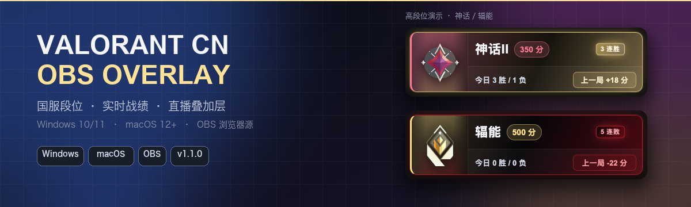
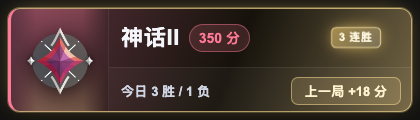
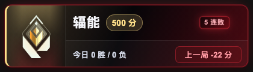
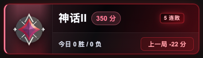
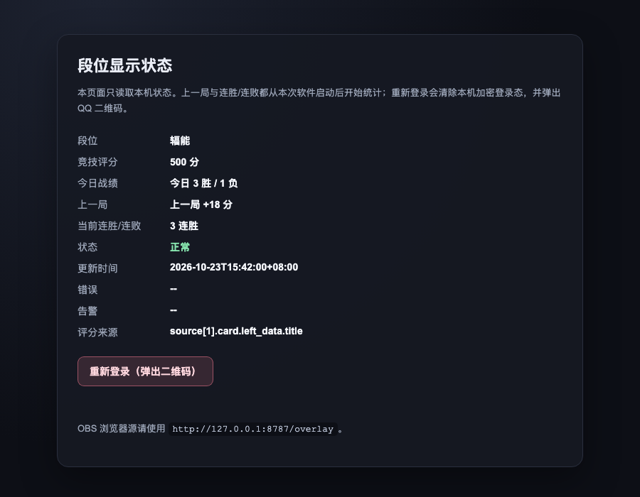

  

<h1 align="center">Valorant CN OBS Overlay</h1>

  <b>国服《无畏契约》段位直播叠加层</b> 
  Windows 10/11 · macOS 12+ · OBS 浏览器源

  
  
  
  
  

  非官方社区工具，与 Riot Games、腾讯及《无畏契约》官方无隶属关系。 
  通过 QQ 扫码登录掌上无畏契约，在本机 OBS 中实时显示段位、RR、今日战绩、上一局变化和连胜/连败。

---

## 效果预览

  
  

神话II · 3 连胜（鎏金呼吸） / 辐能 · 5 连败（红黑呼吸）

  
  

神话II · 5 连败 / 辐能 · 3 连胜

  

本机状态页：辐能 · 500 分 · 3 连胜 · 今日 3 胜 / 1 负

<blockquote>

<b>UI 细节</b>：段位主色会跟着段位变化（神话为粉红、辐能为金色），再叠加上一局胜负色（连胜鎏金、连败红黑）；连胜/连败徽章和整卡呼吸同频，达到 2 场才触发。

</blockquote>

## 特性

| | |
|:--|:--|
| 🎯 **游戏内段位图标** | 直接使用掌瓦段位卡片返回的图标，不用文字冒充段位 |
| 🎨 **段位/胜负动态背景** | 段位主色 + 上一局胜负渐变；连胜鎏金、连败红黑 |
| 🔥 **连胜/连败呼吸动画** | 2 场起显示徽章；卡片与徽章同频呼吸，无扫光 |
| 🖥️ **Windows / macOS** | Windows 10/11 x64；macOS 12+ Apple Silicon / Intel |
| 🔐 **本机加密登录** | Windows DPAPI；macOS Keychain + AES-GCM |
| 📊 **状态页与诊断** | 本机查看状态、错误、RR 来源，一键重新登录 |
| ⚡ **轻量单文件** | Go 标准库，无运行时依赖，不需要 Python/管理员权限 |

## v1.1.0 更新

- 新增 macOS 12+ 支持，Apple Silicon / Intel 双架构。
- 修复网络抖动误删登录态、后台刷新弹二维码、启动必须先登录等问题。
- 补全 QQ 二维码状态码处理：<code>65</code> 失效、<code>53</code> 取消、<code>66/67</code> 继续轮询。
- 新增 <code>/status</code> 状态页、<code>--diagnose</code>、显式重新登录。
- 上一局和连胜/连败只统计**本次软件启动后**的竞技对局，重启归零。
- 完整说明：[v1.1.0 发布说明](docs/releases/v1.1.0.md)

## 快速开始

### Windows

1. 从 [Releases](../../releases/latest) 下载 **Windows x64 ZIP**。
2. **完整解压**到普通文件夹，不要直接在压缩包里运行。
3. 双击 <code>启动段位Overlay.bat</code>。
4. 用 QQ 扫码并确认授权；登录成功后浏览器会打开 Overlay 预览。
5. 保持程序窗口运行，关闭窗口或按 <code>Ctrl+C</code> 停止。

> [!NOTE]
> 不需要安装 Python、pip 或管理员权限。SmartScreen 可能提示“未知发布者”，请先核对 Release 来源和 <code>CHECKSUMS.sha256</code>。

### macOS

1. 从 [Releases](../../releases/latest) 下载 **macOS ZIP**。
2. **完整解压**到普通文件夹。
3. 第一次打开时，右键 <code>启动段位Overlay.command</code> → **打开**。
4. 用 QQ 扫码并确认授权；登录成功后浏览器会打开 Overlay 预览。
5. 保持终端窗口运行，按 <code>Ctrl+C</code> 或关闭终端停止。

如果 Gatekeeper 仍拦截：

~~~bash
xattr -dr com.apple.quarantine /路径/到/解压目录
~~~

> [!NOTE]
> macOS 首次访问 Keychain 时可能弹窗，请选择“允许”。如果 Keychain 不可用，程序会回退到数据目录内的 <code>0600</code> 本地密钥文件，凭证仍然不是明文。

## OBS 设置

OBS → **来源** → **+** → **浏览器**：

| 设置 | 值 |
|:--|:--|
| URL | <code>http://127.0.0.1:8787/overlay</code> |
| 宽度 | <code>420</code> |
| 高度 | <code>120</code> |

建议先启动程序，确认 Overlay 预览正常后再加入 OBS。

## 状态页与诊断

| 功能 | 使用方式 |
|:--|:--|
| 状态页 | <code>http://127.0.0.1:8787/status</code> |
| 健康检查 | <code>http://127.0.0.1:8787/health</code> |
| 重新登录 | 状态页按钮，或运行 <code>重新登录.bat</code> / <code>重新登录.command</code> |
| 本机诊断 | <code>ValorantCNOverlay.exe --diagnose</code> / <code>./ValorantCNOverlay-macos-arm64 --diagnose</code> |

状态页只读取本机缓存，不会额外请求掌瓦。运行中登录失效时不会自动弹二维码，需要手动点“重新登录”。

## 数据与隐私

- **Windows**：<code>%LOCALAPPDATA%\ValorantCNOverlay\credentials.bin</code>，使用 **DPAPI** 加密。
- **macOS**：<code>~/Library/Application Support/ValorantCNOverlay/credentials.bin</code>，使用 **AES-GCM** 加密；密钥优先放在 Keychain。
- 本地 HTTP 服务只监听 <code>127.0.0.1</code>，不会主动开放到局域网。
- <code>/api/state</code> 只提供段位、RR、胜负等展示数据，不提供登录 Token。
- 不要把数据目录上传到 GitHub、网盘或发给其他人。

需要彻底清除登录态：<code>--reset-login</code>

## 常见问题

<b>二维码过期 / 登录失效</b>

二维码真正过期时程序会自动刷新，不需要手动重启。  
如果程序已经退出，重新双击启动器即可。运行中登录失效不会自动弹二维码，请使用状态页的“重新登录”或对应启动器。

<b>OBS 页面空白</b>

先在浏览器打开 <code>http://127.0.0.1:8787/health</code>，正常应返回：

~~~json
{"ok":true}
~~~

再检查 OBS 浏览器源 URL 是否为 <code>http://127.0.0.1:8787/overlay</code>。

<b>数据停止更新</b>

Overlay 会保留最后一次成功数据并显示黄色状态点。可能是网络波动、登录态失效或掌瓦接口变化。  
先查看 <code>http://127.0.0.1:8787/status</code> 的错误/告警；如果是登录失效，点击“重新登录”。

<b>端口 8787 被占用</b>

Windows：

~~~powershell
.\ValorantCNOverlay.exe --port 8788
~~~

macOS：

~~~bash
./ValorantCNOverlay-macos-arm64 --port 8788
~~~

OBS URL 同步改成 <code>http://127.0.0.1:8788/overlay</code>。

<b>命令行参数</b>

| 参数 | 说明 |
|:--|:--|
| <code>--port 8787</code> | 本地 HTTP 端口 |
| <code>--refresh 30</code> | 掌瓦刷新间隔（5–3600 秒） |
| <code>--no-open</code> | 启动后不自动打开浏览器或二维码 |
| <code>--reset-login</code> | 删除本机加密登录态并重新扫码 |
| <code>--data-dir 目录</code> | 自定义数据目录 |
| <code>--diagnose</code> | 检查数据目录、系统安全存储、端口和连通性 |
| <code>--version</code> | 显示版本和 commit |

同一时间只允许一个实例运行。

## 从源码构建

项目只使用 Go 标准库，无第三方 Go module 依赖。

~~~bash
go test ./...
go vet ./...

# macOS：同时构建 Apple Silicon 和 Intel
./scripts/build-macos.sh

# Windows
go build -trimpath -ldflags "-s -w -X main.version=1.1.0" -o ValorantCNOverlay.exe ./src/cmd/valorant-overlay
~~~

GitHub Actions 会运行测试并生成 Windows x64 / macOS ZIP；推送 <code>v*</code> tag 时创建 Release。

## 文档

- [RR 解析与诊断](docs/rr-diagnostics.md)
- [v1.1.0 发布说明](docs/releases/v1.1.0.md)
- [第三方许可与署名](THIRD_PARTY_NOTICES.md)

## 许可

本项目以 **GNU Affero General Public License v3.0 or later (AGPL-3.0-or-later)** 发布。完整条款见 [LICENSE](LICENSE)。

Made for the CN Valorant community · Not affiliated with Riot Games / Tencent

