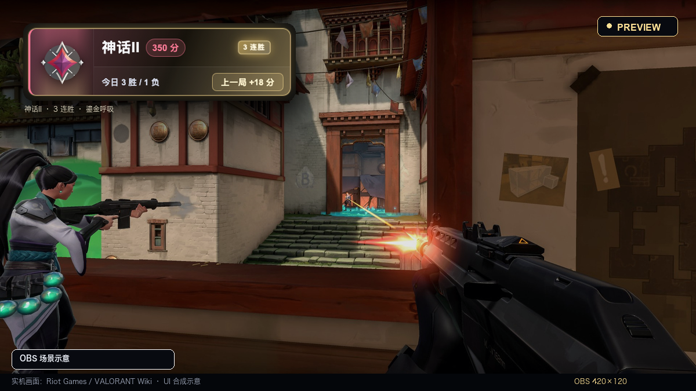
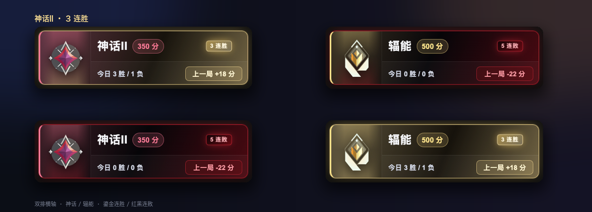
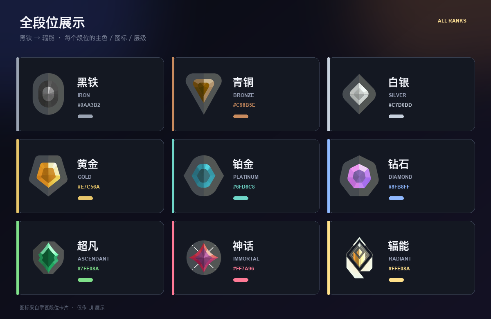
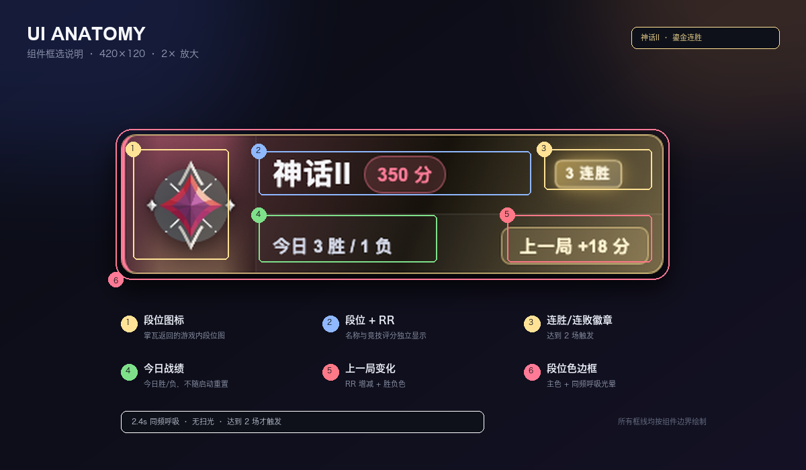
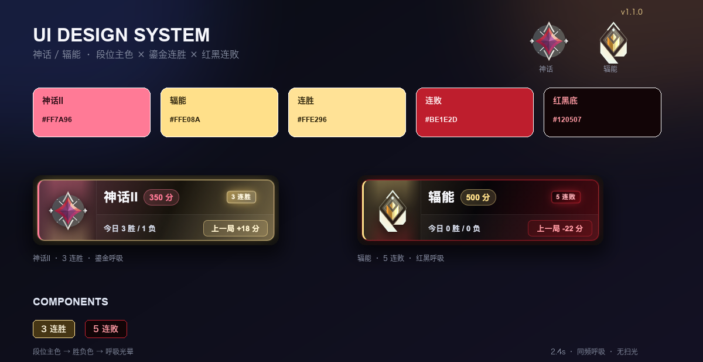
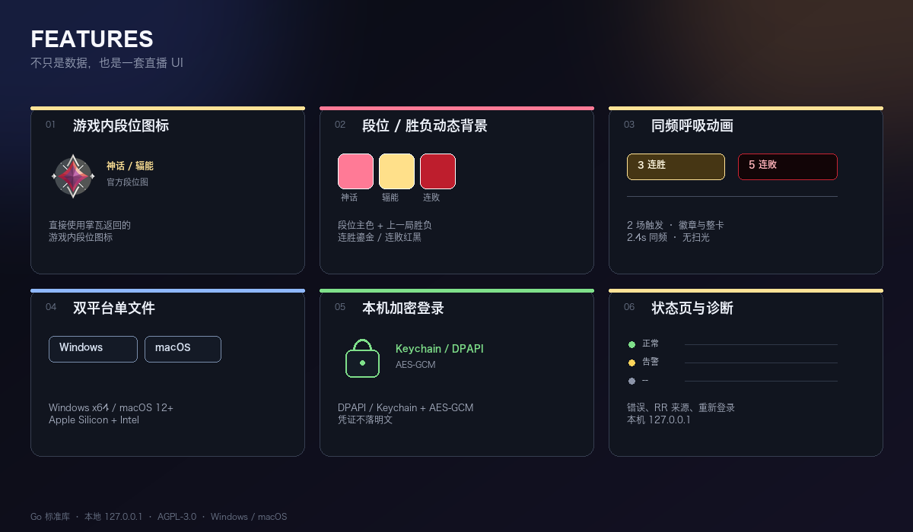
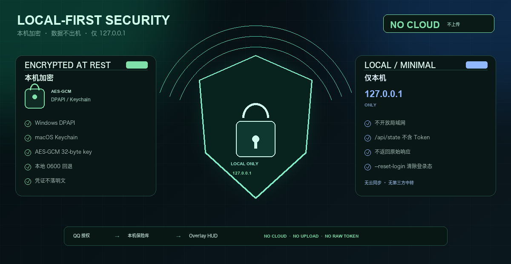

  

<h1 align="center">VALORANT CN OBS OVERLAY</h1>

  <b>国服《无畏契约》段位直播 HUD</b> 
  Windows 10/11 · macOS 12+ · OBS Browser Source

  
  
  
  
  

  <code>420×120</code> · <code>127.0.0.1</code> · <code>STREAM-READY</code> · <code>LOCAL-FIRST</code>

> 非官方社区工具，与 Riot Games、腾讯及《无畏契约》官方无隶属关系。掌瓦接口为非公开接口，官方更新后可能失效。

---

## 01 / LIVE HUD

  

OBS 场景示意 · 420×120 · UI 左上角 · 实机画面：Riot Games / <a href="https://wiki.playvalorant.com/en-us/File:Gameplay_1.jpeg">VALORANT Wiki</a> · 仅作 UI 合成示意

**STREAM-READY HUD**：段位图标、RR、今日战绩、上一局变化、连胜/连败，一块卡全收。

| 参数 | 值 |
|:--|:--|
| Browser Source | <code>http://127.0.0.1:8787/overlay</code> |
| Size | <code>420 × 120</code> |
| Position | 左上 / 任意角 |
| Background | 透明 |

## 02 / UI SYSTEM

  

双排横轴：神话II · 3 连胜 / 辐能 · 5 连败 / 神话II · 5 连败 / 辐能 · 3 连胜

### STATE × COPY

| 实战状态 | UI 文案 | 视觉反馈 |
|:--|:--|:--|
| 神话II · 3 连胜 | 今日 3 胜 / 1 负 · 上一局 +18 分 | 鎏金呼吸 |
| 辐能 · 5 连败 | 今日 0 胜 / 0 负 · 上一局 -22 分 | 红黑警报 |
| 神话II · 5 连败 | 今日 0 胜 / 0 负 · 上一局 -22 分 | 红黑警报 |
| 辐能 · 3 连胜 | 今日 3 胜 / 1 负 · 上一局 +18 分 | 鎏金呼吸 |

~~~text
神话II · 350分 · 3连胜 · 今日 3-1
辐能 · 500分 · 5连败 · 今日 0-0
~~~

### ALL RANKS

  

黑铁 → 辐能 · 官方图标 / 主色 / 层级 · 段位色会直接影响卡片背景

### UI ANATOMY

  

① 段位图标 · ② 段位 + RR · ③ 连胜/连败徽章 · ④ 今日战绩 · ⑤ 上一局变化 · ⑥ 段位色边框

### DESIGN SYSTEM

  

段位主色 / 鎏金连胜 / 红黑连败 / 徽章与 2.4s 同频呼吸

### STATUS PAGE

  

本机状态页：辐能 · 500 分 · 3 连胜 · 今日 3 胜 / 1 负

> **UI 细节**：段位主色跟着段位走（神话粉红、辐能鎏金），再叠加上一局胜负色；连胜鎏金、连败红黑。徽章与整卡同频呼吸，达到 2 场才触发。

## 03 / FEATURES

  

游戏内段位图标 · 段位/胜负动态背景 · 同频呼吸 · Windows / macOS · 本机加密 · 状态页与诊断

## 04 / LOCAL-FIRST SECURITY

  

本机加密 · 数据不出机 · 仅 127.0.0.1 · NO CLOUD / NO UPLOAD

| ENCRYPTED AT REST | LOCAL ONLY | MINIMAL DATA |
|:--|:--|:--|
| Windows DPAPI macOS Keychain + AES-GCM 本地 0600 回退 | 只监听 <code>127.0.0.1</code> 不开放局域网 无云同步 | <code>/api/state</code> 不含 Token 不返回原始响应 <code>--reset-login</code> 可清除 |

- Windows 凭证：<code>%LOCALAPPDATA%\ValorantCNOverlay\credentials.bin</code>
- macOS 凭证：<code>~/Library/Application Support/ValorantCNOverlay/credentials.bin</code>
- 凭证文件本身不是明文 Token；不要把数据目录上传网盘或发给他人。

## 05 / QUICK START

### Windows

1. 从 [Releases](../../releases/latest) 下载 **Windows x64 ZIP**。
2. 完整解压，双击 <code>启动段位Overlay.bat</code>。
3. QQ 扫码授权。
4. 浏览器打开预览，OBS 添加 Browser Source。

> [!NOTE]
> 不需要 Python、pip 或管理员权限。SmartScreen 可能提示未知发布者，请核对 Release 与 <code>CHECKSUMS.sha256</code>。

### macOS

1. 从 [Releases](../../releases/latest) 下载 **macOS ZIP**。
2. 完整解压，右键 <code>启动段位Overlay.command</code> → 打开。
3. QQ 扫码授权；Keychain 弹窗选择“允许”。
4. 保持终端运行，OBS 添加 Browser Source。

如果 Gatekeeper 拦截：

~~~bash
xattr -dr com.apple.quarantine /路径/到/解压目录
~~~

> [!NOTE]
> Keychain 不可用时回退到数据目录内 <code>0600</code> 本地密钥，凭证仍不是明文。

## 06 / OBS SETUP

OBS → **来源** → **+** → **浏览器**：

| 设置 | 值 |
|:--|:--|
| URL | <code>http://127.0.0.1:8787/overlay</code> |
| 宽度 | <code>420</code> |
| 高度 | <code>120</code> |

先启动程序，确认 Overlay 预览正常，再加 OBS。

## 07 / STATUS & DIAGNOSTICS

| 功能 | 使用方式 |
|:--|:--|
| 状态页 | <code>http://127.0.0.1:8787/status</code> |
| 健康检查 | <code>http://127.0.0.1:8787/health</code> |
| 重新登录 | 状态页按钮 / <code>重新登录.bat</code> / <code>重新登录.command</code> |
| 本机诊断 | <code>--diagnose</code> |

状态页只读本机缓存，不额外请求掌瓦。运行中登录失效不会自动弹二维码，需手动重新登录。

## 08 / CHANGELOG

- macOS 12+ 支持：Apple Silicon / Intel 双架构。
- 登录可靠性：网络抖动不再误删登录态；后台刷新不弹二维码。
- 二维码状态码补全：<code>65</code> 失效 / <code>53</code> 取消 / <code>66/67</code> 继续轮询。
- 状态页、<code>--diagnose</code>、显式重新登录。
- 上一局 / 连胜连败只统计本次启动后的竞技对局，重启归零。
- 完整说明：[v1.1.0 发布说明](docs/releases/v1.1.0.md)

## 09 / FAQ

<b>二维码过期 / 登录失效</b>

二维码真正过期会自动刷新；程序退出后重新启动即可。运行中登录失效不会自动弹二维码，请用状态页“重新登录”。

<b>OBS 页面空白</b>

先访问 <code>http://127.0.0.1:8787/health</code>，正常返回：

~~~json
{"ok":true}
~~~

再检查 Browser Source URL。

<b>数据停止更新</b>

Overlay 保留最后一次数据并显示黄色状态点。先看 <code>/status</code> 的错误/告警；登录失效就重新登录。

<b>端口 8787 被占用</b>

~~~powershell
.\ValorantCNOverlay.exe --port 8788
~~~

~~~bash
./ValorantCNOverlay-macos-arm64 --port 8788
~~~

OBS URL 改为 <code>http://127.0.0.1:8788/overlay</code>。

<b>命令行参数</b>

| 参数 | 说明 |
|:--|:--|
| <code>--port 8787</code> | 本地端口 |
| <code>--refresh 30</code> | 掌瓦刷新间隔 5–3600 秒 |
| <code>--no-open</code> | 不自动打开浏览器/二维码 |
| <code>--reset-login</code> | 删除登录态并重新扫码 |
| <code>--data-dir 目录</code> | 自定义数据目录 |
| <code>--diagnose</code> | 数据目录/安全存储/端口/连通性 |
| <code>--version</code> | 版本和 commit |

同一时间只允许一个实例。

## 10 / BUILD

~~~bash
go test ./...
go vet ./...

# macOS 双架构
./scripts/build-macos.sh

# Windows
go build -trimpath -ldflags "-s -w -X main.version=1.1.0" -o ValorantCNOverlay.exe ./src/cmd/valorant-overlay
~~~

GitHub Actions 运行测试并产出 Windows / macOS ZIP；<code>v*</code> tag 创建 Release。

## 11 / DOCS & LICENSE

- [RR 解析与诊断](docs/rr-diagnostics.md)
- [v1.1.0 发布说明](docs/releases/v1.1.0.md)
- [第三方许可](THIRD_PARTY_NOTICES.md)

本项目以 **AGPL-3.0-or-later** 发布，完整条款见 [LICENSE](LICENSE)。

Made for the CN Valorant community · Not affiliated with Riot Games / Tencent

